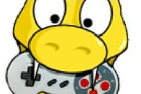

  

<h1 align="center">Curso de Introdução ao Pygame</h1> 

Introdução a biblioteca Pygame da linguagem python com base no curso da Workover realizado no mes 10 de 2021

Tabela de conteúdos
=================
<!--ts-->
   * [Sobre](#Sobre)
   * [Tabela de Conteudo](#tabela-de-conteudo)
   * [Instalação](#Instalação)
   * [Como usar](#como-usar)
      * [Pre Requisitos](#pre-requisitos)
   * [Tecnologias](#tecnologias)
<!--te-->

<h4 align="center"> 
	✔️  Pronto  ✔️
</h4>

## ❓ Sobre

Introdução a biblioteca Pygame da linguagem python com base no curso da Workover realizado no mes 10 de 2021

## ✔️ Tabela de conteudo

- [x] Fase 1
- [x] Fase 2
- [x] Fase 3
- [x] Fase 4

## ❓ Instalação

Para instalar esse projeto na sua maquina basta ter o git e digitar o seguinte codigo

<code> git clone https://github.com/Taunt-byte/Curso-Introducao-Pygame.git </code>

## ❓ Como usar

Para jogar o jogo basta executar o arquivo aula13.py que o jogo ira iniciar

## 🔨 Pre Requisitos

Para aproveitar desse projeto você deve seguir os sequintes passos:

1) Primeiramente você deve possuir o git devidamente instalado em sua maquina

2) Depois do git você deve ter o python devidamente instalado em sua maquina junto com a biblioteca pygame

3) E por ultimo deve possuir um bom editor de texto para a edição e execução do codigo (recomendo que use o VScode)

## 🚀 Tecnologias

<table>
    <tr>
    <td>Python</td>
    </tr>
    <tr>
    <td>3.9.7</td>
    </tr>
</table>